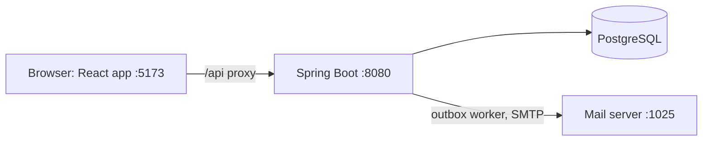
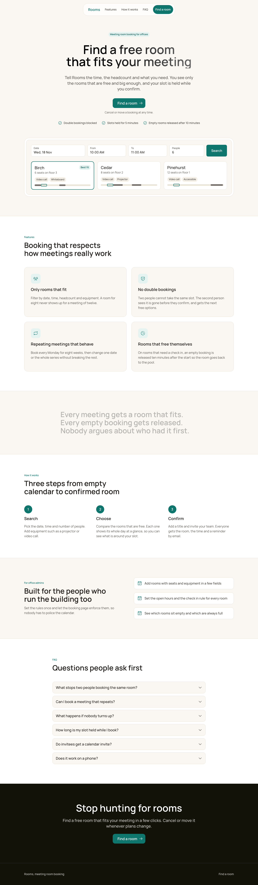
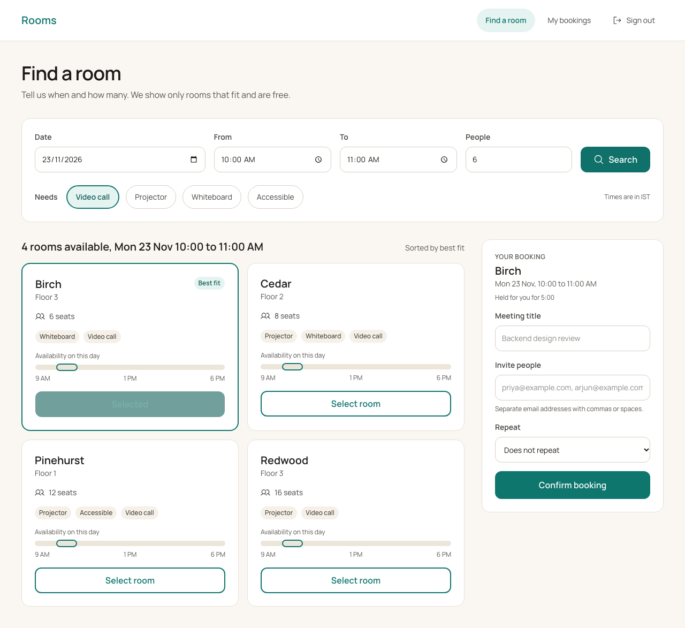
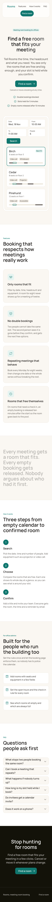
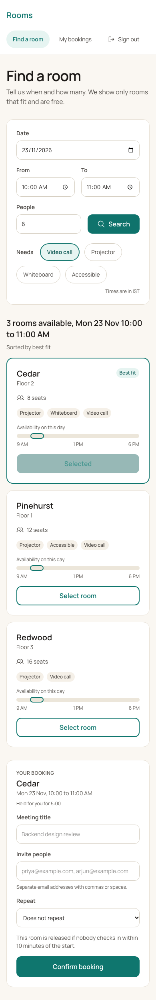

# Rooms

Meeting room booking. Employees search by date, time, headcount and equipment, see only rooms that are free and big enough, book one, and get a confirmation email with a calendar invite. Admins manage rooms. A public landing page leads into the search.

Stack: Spring Boot 3 (Java 21 target), PostgreSQL 16, Flyway, JWT auth, Thymeleaf email with an outbox, React 18, Vite, Tailwind, TanStack Query.



## Run it locally

You need Java 21 or newer, Node 22 or newer and PostgreSQL 16. No containers are used.

```bash
# 1. database (once). On macOS: brew install postgresql@16 && brew services start postgresql@16
createdb rooms
createdb rooms_test

# 2. a mail catcher on SMTP 1025 and http://localhost:8025 (or run Mailpit instead)
node tools/mail-sink.mjs
```

```bash
# 3. backend, seeds six rooms and two users on first start
cd backend && ./mvnw spring-boot:run
```

```bash
# 4. frontend
cd frontend && npm install && npm run dev
```

Open http://localhost:5173. Swagger UI is at http://localhost:8080/swagger-ui.html. Sent emails are listed at http://localhost:8025.

Development accounts, created by the dev profile only:

| Email | Password | Role |
| --- | --- | --- |
| admin@rooms.local | admin-dev-pass | Admin |
| employee@rooms.local | employee-dev-pass | Employee |

Configuration comes from environment variables, see `.env.example`. The database user defaults to your OS user with no password.

## Checks

```bash
cd backend && ./mvnw verify          # tests, jacoco report, spotless check
cd frontend && npm run lint && npm test && npm run build
cd frontend && npm run e2e           # needs backend, frontend and the mail catcher running
cd frontend && node scripts/screenshots.mjs   # refreshes screenshots/
```

Backend tests use a real PostgreSQL (`rooms_test`) so the overlap exclusion constraint is exercised, and GreenMail for email.

## Screenshots

| | |
|---|---|
|  |  |
|  |  |

`design/mockups/` holds the HTML design references. They are not shipped.
