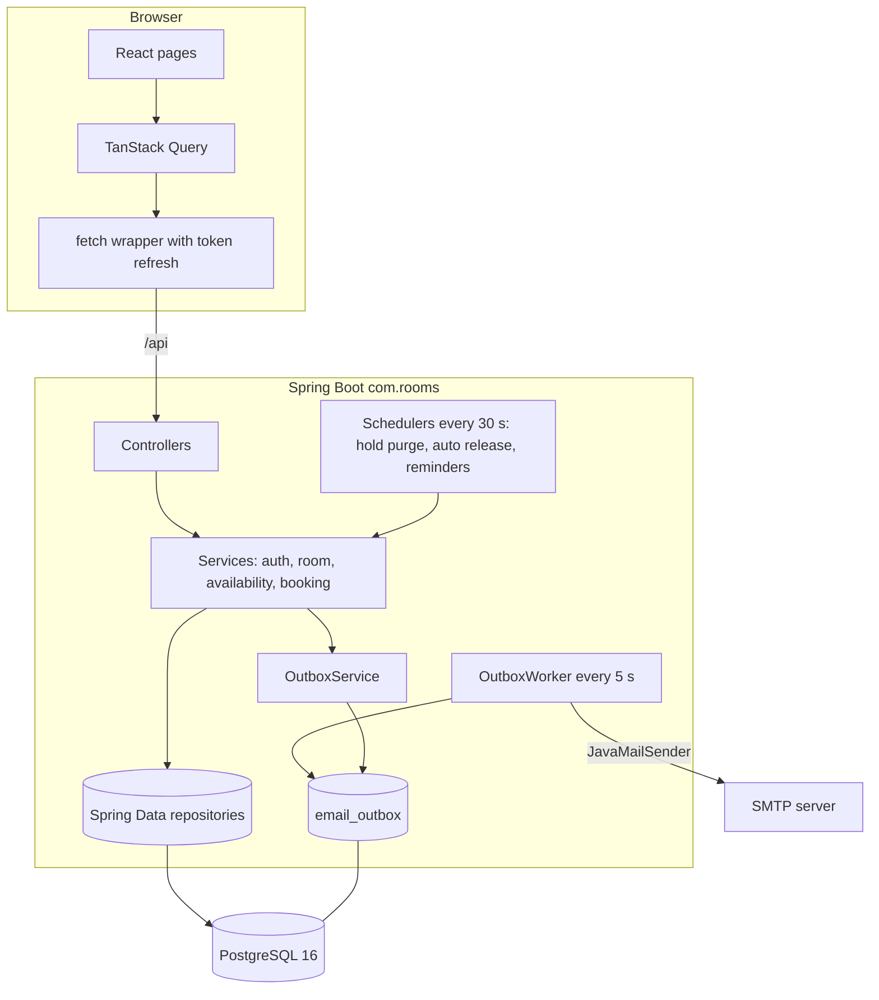

# Architecture

## Booking rules in one place

- Overlaps are blocked by a PostgreSQL exclusion constraint (`btree_gist`, room plus `tstzrange(starts_at, ends_at, '[)')`, only for CONFIRMED rows). The service also locks the room row while it checks and inserts so users get a clean 409 with alternatives, never a 500.
- A hold is a row in `slot_holds` that expires after 5 minutes. Search and booking ignore expired holds even before the scheduler deletes them.
- Series are created in one transaction. One conflicting date rolls everything back and the 409 names the dates.
- Email: the booking transaction inserts one `email_outbox` row per recipient. A unique key on booking, type, recipient and booking version makes duplicates impossible. The worker takes due rows with `FOR UPDATE SKIP LOCKED`, sends, and backs off 1 minute, 5 minutes, 30 minutes, 2 hours, then marks FAILED after 5 attempts. SMTP being down never fails a booking.

## Frontend

Routes: `/` landing, `/login`, `/register`, `/rooms/find`, `/bookings`, `/bookings/:id`, `/admin/rooms`, `/admin/bookings`. The Vite dev server proxies `/api` so the refresh cookie stays same origin. Access tokens live in memory only.
